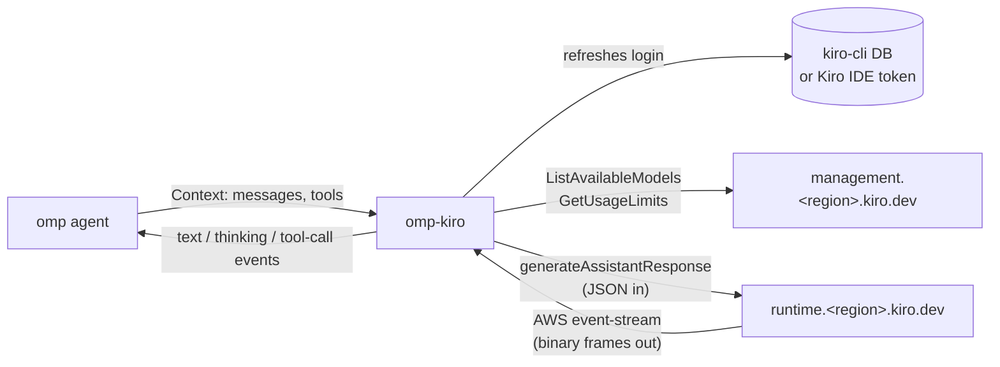

<!-- rumdl-disable MD033 -->
<h1 align="center">omp-kiro</h1>

<div align="center">

**Use the models from your Kiro subscription inside
[oh-my-pi](https://github.com/can1357/oh-my-pi) (`omp`).**


</div>
<!-- rumdl-enable MD033 -->

---

This is an `omp` extension. It registers a `kiro` provider, so every model on
your Kiro plan shows up as `kiro/<model>` next to omp's built-in providers. It
signs in with your existing `kiro-cli` login and talks to Kiro's own API
directly. There's no proxy server to run and no API key to paste into omp.

```console
$ omp models find kiro
kiro (21)
│ claude-opus-5.5   │ 1M   │ 128K │ low,medium,high,xhigh,max │ yes │
│ claude-sonnet-5.5 │ 1M   │ 128K │ low,medium,high,xhigh,max │ yes │
│ gpt-5.6-luna      │ 1M   │ 128K │ low,medium,high,xhigh,max │ yes │
│ deepseek-3.2      │ 164K │ 64K  │ -                         │ no  │
│ ...
```

> [!NOTE]
> This is an unofficial community project. It isn't affiliated with or endorsed
> by Kiro, Amazon/AWS, or oh-my-pi. It uses the same endpoints the Kiro clients
> use, and those can change without notice. Check that using your subscription
> this way fits Kiro's terms for your account.

## What works

- Streaming text, extended thinking, and tool calls, including parallel tool
  calls and signed thinking that carries across tool turns.
- The model list is fetched live from Kiro. Context window, output limit, image
  support, and the allowed thinking levels all come from Kiro's per-model
  schema, so new models appear without a plugin update.
- `--thinking <level>` maps to Claude's `thinking` + `output_config.effort`, or
  to GPT's `reasoning.effort`. A level the model doesn't support is clamped to
  the nearest one it does.
- `omp usage` shows your monthly Kiro credits, the plan name, and the reset
  date.
- Tokens are refreshed automatically and written back where kiro-cli keeps them,
  so kiro-cli stays signed in too.

## Requirements

- [`omp`](https://github.com/can1357/oh-my-pi) 18.4.x. The plugin runs inside
  omp's bundled Bun runtime.
- A Kiro account signed in with `kiro-cli login` (IAM Identity Center, Builder
  ID, or social login). If kiro-cli has no login, the Kiro IDE's login is used
  instead.

## Install

```sh
omp plugin install github:MrDwarf7/omp-kiro
```

omp clones the repo into its own plugins folder (`~/.omp/plugins`) and checks
that the extension loads before enabling it. Install a specific release by
pinning its tag, for example `github:MrDwarf7/omp-kiro#v0.1.0`. To publish a
later release, update `package.json`, run the tests and typecheck, commit, then
push a matching `v<version>` tag. GitHub creates the release with generated
notes.

Update or remove it later with:

```sh
omp plugin upgrade omp-kiro
omp plugin uninstall omp-kiro
```

Check that the models are there, then use one:

```sh
omp models find kiro
omp --model kiro/claude-sonnet-5.5 --thinking high
```

> [!TIP]
> On the command line, pass the thinking level with `--thinking`. The
> `kiro/<model>:high` form isn't resolved at startup for extension providers. It
> does work inside a running session.

Nothing else gets installed. The plugin has no runtime dependencies, and omp
supplies the `@oh-my-pi/*` packages it imports.

## How it works



Kiro doesn't speak the OpenAI or Anthropic API. Requests use the CodeWhisperer
`conversationState` format: turns strictly alternate between user and assistant,
the last user turn is sent separately as the current message, tool definitions
travel on that current message, and each set of tool results has to answer
exactly the tool calls in the assistant turn before it. Responses come back as
AWS event-stream binary frames, not SSE. The plugin converts both ways:

| File                 | Job                                                                                                            |
| -------------------- | -------------------------------------------------------------------------------------------------------------- |
| `src/auth.ts`        | Find the login, refresh it (AWS SSO OIDC, or Kiro's own refresh endpoint for social logins), write it back     |
| `src/request.ts`     | omp `Context` → Kiro request: turn merging, tool-result pairing, tool-name sanitizing, images, thinking replay |
| `src/eventstream.ts` | Incremental, CRC-checked AWS event-stream decoder                                                              |
| `src/stream.ts`      | Kiro events → omp's streaming events, stop reasons, usage, errors, stall timeouts                              |
| `src/models.ts`      | Turns Kiro's per-model schemas into omp model entries and thinking levels                                      |
| `src/usage.ts`       | Monthly credit usage for `omp usage`                                                                           |

A few Kiro quirks the code works around:

- Kiro rejects a top-level system prompt field, so omp's system prompt is put at
  the start of the first user turn.
- Kiro sends a token-usage structure but leaves it empty. Input tokens are
  estimated from the context-usage percentage Kiro reports, and output tokens
  from the response length. Cost shows as `$0`; credits are what you're actually
  billed.
- omp's stall watchdog only covers its built-in providers, so the plugin has its
  own: 180 s for the first byte and 120 s between chunks. omp's
  `streamFirstEventTimeoutMs` and `streamIdleTimeoutMs` options override both.

## Configuration

Everything is picked up from the login automatically. These environment
variables are only for unusual setups:

| Variable           | Effect                                                            |
| ------------------ | ----------------------------------------------------------------- |
| `KIRO_CLI_DB`      | Path to kiro-cli's `data.sqlite3`                                 |
| `KIRO_IDE_TOKEN`   | Path to the Kiro IDE's `kiro-auth-token.json`                     |
| `KIRO_AUTH_SOURCE` | `kiro-cli` or `kiro-ide`, to force one login source               |
| `KIRO_CLI_BIN`     | kiro-cli binary used as a last-resort refresh (`kiro-cli whoami`) |

The service region comes from your Kiro profile ARN. The region used for token
refresh comes from the login itself. They're often different: an Identity Center
instance in `ap-southeast-2` can still have its Kiro profile in `us-east-1`.

## Development

For working on the plugin, link a local checkout instead of installing it. omp
then loads your working tree directly, so edits apply on the next `omp` start:

```sh
git clone https://github.com/MrDwarf7/omp-kiro.git
cd omp-kiro
omp plugin link .
```

```sh
bun install          # dev-only: type packages and the TypeScript compiler
bun test             # 70 tests, no network
bunx tsc --noEmit    # strict typecheck
```

The tests use a captured `ListAvailableModels` response (`test/fixtures/`) and
locally built event-stream frames. They never contact Kiro.

`omp plugin link` and `omp plugin install` both register the plugin under the
name `omp-kiro`, so the most recent one wins. Run the other command to switch
back.

## Troubleshooting

- **`No Kiro login found`**: run `kiro-cli login`, or sign in to the Kiro IDE.
- **`Kiro login expired and could not be refreshed`**: the refresh token itself
  has expired. Run `kiro-cli login` again.
- **`prompt is too long`**: Kiro rejected the request for exceeding the model's
  context window. omp treats this as a context overflow and compacts.
- **Kiro models missing from `omp models`**: omp caches the model list for 24
  hours. Refresh it with `omp models refresh`, and check that `omp plugin list`
  shows `omp-kiro`.
